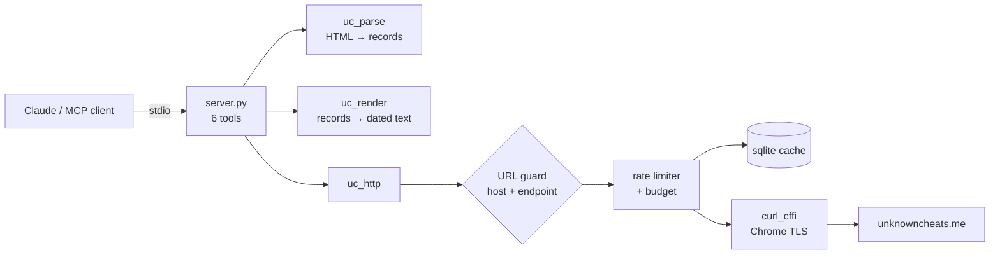

<div align="center">

# uc-mcp

**Search UnknownCheats from Claude Code, with a date on every result.**

A read-only [MCP](https://modelcontextprotocol.io) server that gives Claude
(or any MCP client) search and thread reading on the UnknownCheats forum
through your own logged-in session. It marks every result with its age,
because on this forum an old answer is usually a wrong one.

[](https://github.com/0111-0222/uc-mcp/actions/workflows/ci.yml)
[](https://www.python.org)
[](https://modelcontextprotocol.io)
[](https://code.claude.com/docs)
[](#account-safety)
[](#install)
[](https://github.com/astral-sh/ruff)
[](LICENSE)

[Install](#install) · [Login](#2-log-in) · [Usage](#usage) ·
[Account safety](#account-safety) · [Troubleshooting](#troubleshooting)

</div>

---

```text
UC search: "entity list" · threads · sorted newest · 23 total · page 1/2 · 3 threads
now=2026-09-30 12:00Z · all dates UTC · (age) after each date

 1. 2026-09-28 (2d)  [Coding] Entity list walker for the current build
    example-game/2000101-entity-list-walker.html  ·  by carol_sdk  ·  41 replies, 6.2k views · 3pg
 2. 2025-11-02 (10mo)  [Question] Entity list pointer changed after update
    example-game/2000102-entity-list-pointer-changed.html  ·  by erin  ·  12 replies, 1.9k views
 3. 2019-03-14 (7.5y)  [Release] Entity list dumper  <- ANCIENT
    example-game/2000103-entity-list-dumper.html  ·  by frank  ·  88 replies, 31k views · 5pg
```

## Why

Public docs on game hacking, anti-cheat and reverse engineering are thin,
stale or wrong. The current answers are on UnknownCheats, and a model can't
read it without an account. This server lets it read the forum with yours,
and puts dates first:

- **Every row carries a date and an age.** Dates are converted to UTC from the
  forum's own timezone.
- **Stale content is labelled** `<- OLD` / `<- ANCIENT`, with a warning line
  the model can't skim past. Offsets and signatures die on a game patch; a
  bypass dies when the anti-cheat ships a detection.
- **Long threads point to their last page.** Page 1 of a ten-year thread is
  usually worthless.
- **Code blocks survive intact** (on this forum the code *is* the answer), and
  quote chains collapse to one line.
- **Output is compact text, not JSON**, so results cost fewer tokens.

## Install

You need **Python 3.10+**, an **UnknownCheats account**, and
**[Claude Code](https://code.claude.com/docs)** (or another MCP
client).

### 1. Clone and install

```bash
git clone https://github.com/0111-0222/uc-mcp.git
cd uc-mcp
```

**Windows (PowerShell):**

```powershell
.\install.ps1
```

**macOS / Linux:**

```bash
./install.sh
```

The script creates `.venv`, installs the dependencies, and prints the exact
commands for the next two steps.

<details>
<summary>Using <code>uv</code> instead</summary>

```bash
uv sync
uv run server.py login
claude mcp add --scope user unknowncheats -- uv run --directory "$PWD" server.py
```

</details>

### 2. Log in

Run the login command the install script printed:

```bash
.venv/bin/python server.py login          # Windows: .venv\Scripts\python.exe server.py login
```

A Chrome, Edge or Brave window opens on the forum. Log in the way you always
do, with **Remember Me** ticked, then close the window. You see:

```text
Logged in as yourname. Login saved.
```

That is the whole step. No dev tools, no file to edit.

- **The window is a separate browser profile** that belongs to uc-mcp. Your
  everyday profile, its history and its other logins are never opened.
- **It is an ordinary window.** Nothing is attached to it while you log in.
  The cookies are read after you close it, from a second, invisible run of
  that profile that opens no page.
- **Only the forum's own cookies are read** (names starting with `bb`, plus
  `cf_clearance`), and the login is saved only after one live request through
  the server's own client has confirmed it works.
- **Remember Me matters.** Without it the browser forgets the login when the
  window closes, and there is nothing to read.
- **The login is saved outside this folder**, in your user data directory
  (`%LOCALAPPDATA%\uc-mcp`, `~/Library/Application Support/uc-mcp` or
  `~/.local/share/uc-mcp`). On Windows it is sealed with DPAPI, so only your
  Windows account can open it; on macOS and Linux it is a file only you can
  read.
- **When it stops working**, ask Claude to log in again. The `uc_login` tool
  first checks the sign-in profile; you are normally still logged in there, so
  it renews the login without opening anything.

| Command | What it does |
| --- | --- |
| `server.py login` | Open the sign-in window and save the login |
| `server.py status` | Check the login with one live request, from a terminal |
| `server.py logout` | Delete the saved login and the sign-in profile |

**Firefox users can skip this.** If you are logged into
[unknowncheats.me](https://www.unknowncheats.me/forum/) in Firefox with
"remember me" ticked, the server reads that login straight from Firefox's
cookie store, with the matching User-Agent, and re-reads it whenever a request
is blocked. Those values are held in memory and never written to disk. The most
recently used logged-in profile wins; pin one with `UC_MCP_FIREFOX_PROFILE`.

<details>
<summary>No browser on this machine (server, container, SSH)</summary>

```bash
.venv/bin/python server.py login --paste
```

On a machine that does have a browser: open a logged-in forum tab, press
<kbd>F12</kbd>, open **Network**, refresh, right-click the first request and
choose **Copy > Copy as cURL**. Paste it into the prompt and press Enter on an
empty line. The cookies and User-Agent are picked out of it, checked against
the forum, and saved the same way. Cloudflare ties a clearance to the IP that
earned it, so this works best when both machines share one.

A `cookies.json` from an older version of uc-mcp is still read if nothing else
is available.

</details>


### 3. Register with Claude Code

Use the command the install script printed (absolute paths). It looks like:

```bash
claude mcp add --scope user unknowncheats -- "/path/to/uc-mcp/.venv/bin/python" "/path/to/uc-mcp/server.py"
```

On Windows the interpreter is `.venv\Scripts\python.exe`. `--scope user` makes
the server available in every project. Remove it with
`claude mcp remove unknowncheats`.

<details>
<summary>Claude Desktop, Cursor, and other MCP clients</summary>

Add this to the client's MCP config (`claude_desktop_config.json`,
`.cursor/mcp.json`, …):

```json
{
  "mcpServers": {
    "unknowncheats": {
      "command": "C:\\path\\to\\uc-mcp\\.venv\\Scripts\\python.exe",
      "args": ["C:\\path\\to\\uc-mcp\\server.py"]
    }
  }
}
```

</details>

### 4. Check it

```bash
.venv/bin/python server.py status
```

You should see `session : logged in, Cloudflare passed`. Inside Claude Code,
asking it to "call uc_session with reload=True" shows the same report.

## Usage

Just ask. The tool descriptions already tell the model to reach for UC on
game-hacking, anti-cheat and RE questions:

> What's the current way people are getting the entity list in Rust? Only trust stuff from the last 6 months.

> Find the canonical thread on manual mapping and summarize the newest page.

> List the Valorant subforum and tell me what's active this week.

### Tools

| Tool | What it does |
| --- | --- |
| `uc_search(query, forum, since, sort, mode, title_only, page, limit)` | Keyword search. `mode="threads"` gives one row per thread (best for finding the definitive thread); `mode="posts"` gives individual dated posts with snippets. |
| `uc_thread(path, page, chars)` | Read a thread's posts. `page="last"` jumps to the newest. |
| `uc_forum(slug, page, limit)` | No slug: every subforum and its slug. With a slug: that board's threads. |
| `uc_fetch(path, chars)` | Fallback: any forum page as cleaned text. |
| `uc_session(reload, clear_cache)` | Session health, login source, request budget, cache. `reload=True` re-reads the login and probes it. |
| `uc_login(wait)` | Opens the sign-in window when the login is missing or expired. The only tool that is not a read; no password or cookie passes through the conversation. |

### Searching well

vBulletin ORs loose terms and stops counting at 500, so **extra words widen
the search instead of narrowing it**. A long natural-language query just
returns the forum's newest posts. Measured on one query:

| Query | Result |
| --- | --- |
| `"manual map" injection detection` | 500 (cap). Top hits were about YOLO mouse input and Arduino colorbots |
| `"manual mapping"`, `mode="threads"`, `title_only=True` | 105 threads, every title on topic |
| ...plus `forum="anti-cheat-bypass"` | 23 |
| ...plus `forum="rust"` | 2 |

So: one `"quoted phrase"`, `mode="threads"` with `title_only=True` first,
`forum=` to scope it, and post mode only if that finds nothing. A header
reading `500+ (result cap)` means the ranking is meaningless, and the tool
says so.

### Making it the first stop

To make "check UC first" a hard rule in a project, add this to its
`CLAUDE.md`:

```markdown
## Game hacking / anti-cheat / RE questions
Before answering from memory or searching the web, call `uc_search` first.
Public documentation on these topics is thin, stale, or wrong. Check the dates
on what comes back: anything older than a year is reference-only — the method
may hold, the offsets and signatures will not.
```

## Account safety

This server uses **your** logged-in session, so it's built to behave like a
careful human reader and to never put the login at risk.

**What it will never do**

- **Write anything.** No tool can post, reply, rate, report, subscribe or PM.
  Account and posting endpoints (`login.php`, `private.php`, `newreply.php`,
  `profile.php`, `usercp.php`, `attachment.php`, anything carrying a
  `securitytoken` or `logouthash`, …) are refused before a request is made.
- **Send your cookies anywhere but unknowncheats.me.** Forum posts are
  attacker-controlled text, and a post can try to talk the model into fetching
  a link. Every URL is parsed, not string-matched, so look-alikes such as
  `https://evil.com?.unknowncheats.me/` are rejected. The cookies are also
  pinned to the `.unknowncheats.me` domain inside curl itself, so even a
  redirect can't carry them off-site. Both guarantees are covered by tests.
- **Follow instructions from posts.** Every result is marked as untrusted
  third-party data.

**How it keeps traffic human-shaped**

| Control | Value | Why |
| --- | --- | --- |
| Between searches | 17s + up to 2s jitter | The forum enforces 15s between searches and rejects anything faster. |
| Between page reads | 4s + jitter | Reads are cheap; paying the search price would make threads unusable. |
| Hourly cap | 150 requests | Keeps sustained use from looking like a scraper. |
| Daily cap | 1000 requests | Same. |
| Jitter | 0–2s random | Exactly periodic requests are a bot signature. |
| TLS | Browser impersonation | Handshake matches the browser the cookies came from, with its real User-Agent. |

The limits are process-wide, and the last send time is kept on disk, so a new
Claude Code session can't fire straight into the forum's throttle. Pages are
cached in `.cache/uc.sqlite3` (threads and searches 15 min, forum listings 10,
the board index 6 hours), and paging a search re-uses its server-side
`searchid`, so going back to a result costs one cheap read, not a new search.

**What's on you**

- **Never share your login.** Don't paste a `Cookie:` header, a copied cURL
  command, a HAR file, the saved `session` file or an old `cookies.json` into
  an issue, a chat or Discord. Anyone holding one is you on the forum. Everyone
  who uses this runs it with their **own** account.
- **The saved login includes `bbpassword`**, vBulletin's "remember me" token.
  It is what lets the login outlive a browser session, and it is as sensitive
  as the copy your browser keeps, which is why it is stored sealed and outside
  the checkout. `server.py logout` deletes it. In Firefox mode it is read from
  the browser on demand and never copied anywhere.
- **Know the risk.** Automated access to a logged-in account always carries
  some ban risk, and the forum's rules are the forum's call. The limits above
  are mitigation, not a guarantee. Use it the way you'd read the forum
  yourself.

## Troubleshooting

| Symptom | Fix |
| --- | --- |
| `not signed in to the forum` | Run `server.py login`, or ask Claude to log in (it calls `uc_login`). |
| `session is browsing as a guest` / `Redirected to login` | The login expired. Ask Claude to log in again, or run `server.py login`. Tick **Remember Me** so it lasts. Firefox mode: log into the forum in Firefox with "remember me" ticked. |
| `Cloudflare blocked the request` | Log in again the same way. Firefox mode: open the forum in Firefox once so it gets a new clearance, then retry. |
| Still blocked by Cloudflare right after a successful-looking login | Cloudflare is challenging every visitor, and a clearance earned by a Chrome newer than the server's TLS profile is not accepted from the server. Update `curl_cffi` (`pip install -U curl_cffi`), or log into the forum in Firefox and let the server read that login instead. |
| `no Chrome, Edge, Brave or Chromium found` | Set `UC_MCP_BROWSER` to the browser's path, use Firefox, or run `server.py login --paste`. |
| `source` in `uc_session` is not the one you expect | Sources are tried in order: saved login, Firefox, `cookies.json`. Force one with `UC_MCP_SOURCE`. |
| `local budget spent` | The hourly or daily cap was hit. Wait; the message says which. |
| `the forum's own search throttle rejected this` | Another search (maybe from your browser) went out less than 15s ago. Retry shortly. |
| `no subforum slug "..."` | Use the URL segment, not the display name. `uc_forum()` with no argument lists them. |
| `500+ (result cap)` in a search header | The query saturated. See [Searching well](#searching-well). |
| Server not showing up in Claude Code | Register with **absolute** paths, and check with `claude mcp list`. |

## How it works



Three things are load-bearing, each verified against the live site:

- **`curl_cffi` with browser impersonation, not `httpx` or `requests`.** The
  Cloudflare WAF fingerprints the TLS handshake, so it is matched to the browser
  the cookies came from (Firefox or Chrome). A plain Python client gets a
  hard 403 no matter how correct the cookies are.
- **Search is a POST with a `securitytoken`.** A GET against
  `search.php?do=process` doesn't run a search on this vBulletin. The token is
  scraped, cached, and refreshed automatically if rejected.
- **Selectors are confirmed against real authenticated HTML.** UC runs a
  vBulletin 3-era template set: `td[id=f<id>]` for boards, `td[id=td_threadtitle_<tid>]`
  for thread rows, `table[id=post<pid>]` + `div[id=post_message_<pid>]` for
  posts.

| File | Role |
| --- | --- |
| [`server.py`](server.py) | The MCP tools and their argument handling |
| [`uc_auth.py`](uc_auth.py) | The sign-in window, the pasted-request fallback and the saved login |
| [`uc_cli.py`](uc_cli.py) | `login`, `status` and `logout` from a terminal |
| [`uc_http.py`](uc_http.py) | URL guard, cookie jar, rate limiter, budget, sqlite cache |
| [`uc_browser.py`](uc_browser.py) | Reads the live login from a Firefox profile |
| [`uc_parse.py`](uc_parse.py) | vBulletin HTML → threads, posts, search hits |
| [`uc_render.py`](uc_render.py) | Records → compact, dated, staleness-labelled text |
| [`uc_dates.py`](uc_dates.py) | Forum date formats → UTC, ages, rot tiers |

### Configuration

| Env var | Default | Purpose |
| --- | --- | --- |
| `UC_MCP_SOURCE` | `auto` | `auto`: the saved login, then Firefox, then `cookies.json`; each is tried when the one before is blocked. `login`, `firefox` or `file` forces one. |
| `UC_MCP_HOME` | your user data directory | Where the saved login and the sign-in browser profile live |
| `UC_MCP_BROWSER` | first of Chrome, Edge, Brave, Chromium | Path of the browser the sign-in window uses |
| `UC_MCP_FIREFOX_PROFILE` | most recently used | Path of the Firefox profile folder to read |
| `UC_MCP_USER_AGENT` | derived from the profile | Override if your Firefox sends a non-default User-Agent |
| `UC_MCP_COOKIES` | `./cookies.json` | A hand-exported cookie file from an older setup, if you still use one |
| `UC_MCP_CACHE` | `./.cache/uc.sqlite3` | Page cache and request ledger |

## Development

```bash
pip install -r requirements.txt pytest ruff
pytest        # offline: synthetic fixtures + a loopback server, no forum traffic
ruff check .
```

The test suite never touches the forum. Parsers run against hand-written
fixtures that mirror UC's markup, and the cookie-pinning test points both
`www.unknowncheats.me` and a look-alike host at a local server to check which
one gets the login.

## License

[MIT](LICENSE). Not affiliated with UnknownCheats. You are responsible for how
you use your account.
